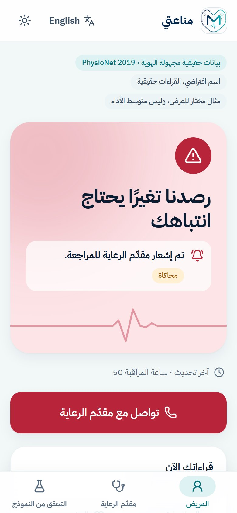
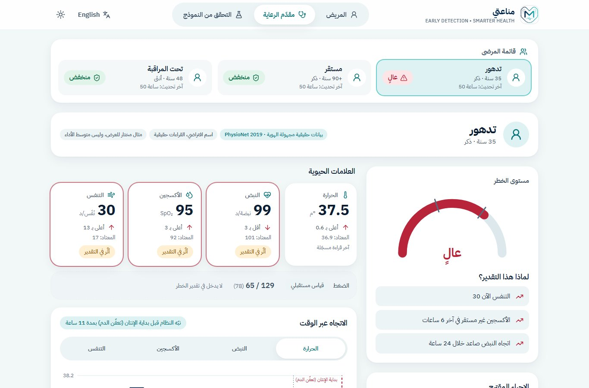
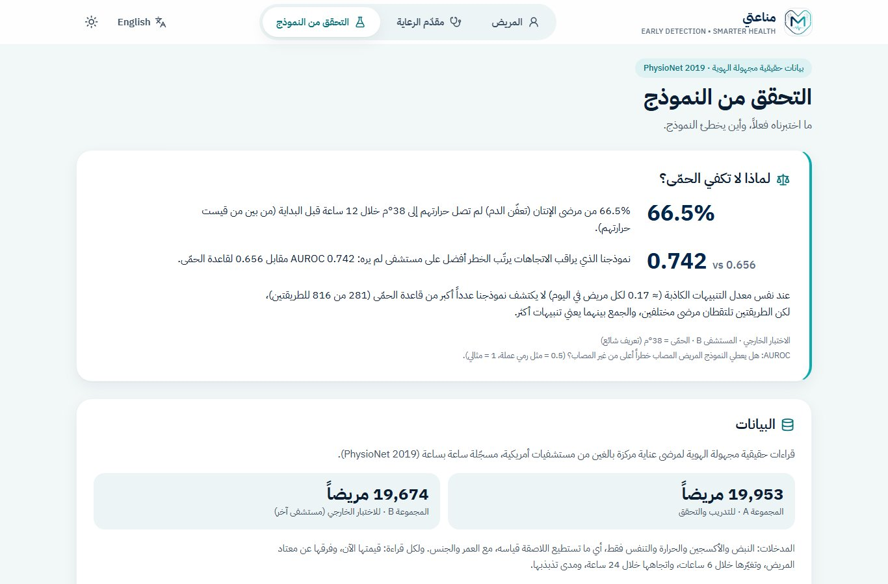

# مناعتي (Manaaty)

نظام إنذار مبكر لتدهور الحالة والعدوى: يقارن قراءات المريض بمعتاده هو، ويراقب اتجاه التغيّر، ثم يعرض مستوى خطر (منخفض / متوسط / عالٍ) مع سببه. نموذج أولي للبحث والعرض (MEDATHON 2026)، وليس أداة تشخيص طبي.

<p align="center">
  
  &nbsp;
  
</p>
<p align="center"></p>

## الشاشات

| التبويب | ماذا فيه |
|---|---|
| **المريض** (Patient) | بطاقة حالة هادئة بمستوى (منخفض / متوسط / عالٍ) بلا نسبة مئوية، وإشعار مقدّم الرعاية (محاكاة)، والقراءات الأربع. |
| **مقدّم الرعاية** (Provider) | قائمة المرضى (الأخطر أولاً)، وتفاصيل المريض المختار: مقياس الخطر، و«لماذا؟»، والعلامات مقابل معتاد المريض، والرسم، والإجراء المقترح، وسجل التنبيهات. |
| **التحقق من النموذج** (AI Validation) | لماذا لا تكفي الحمّى؟ والبيانات، والاختبار الخارجي، والمقارنة، وأهم العوامل، وحالة أخطأ فيها النموذج، والحدود، والمصدر. |

ثلاثة سيناريوهات بقراءات حقيقية: **مستقر** و**تحت المراقبة** و**تدهور**، مع شريط «وضع العرض» لإعادة تشغيلها ساعة بساعة. تصميم اللاصقة نفسها في العرض التقديمي وملف Technical Prototype.

## جرّبه

الرابط المباشر: https://manaaty-medathon.vercel.app

أو محلياً (يحتاج Node 20 أو أحدث):

```bash
cd web && npm install
npm run dev
```

التطبيق يُثبَّت على الجوال ويعمل بدون إنترنت. لا يوجد خادم: نتائج النموذج محسوبة مسبقاً ومحفوظة كملفات JSON في `web/src/data/`.

## حقيقي أم محاكاة؟

| العنصر | الحالة |
|---|---|
| قراءات المرضى في العرض | **حقيقية مجهولة الهوية** (PhysioNet 2019)، والأسماء أسماء سيناريوهات افتراضية: «مستقر»، «تحت المراقبة»، «تدهور» |
| نموذج الخطر وأرقام الاختبار | **حقيقي**: مدرَّب ومُختبر على هذه البيانات |
| حدود منخفض / متوسط / عالٍ | **قرار تصميم منا** فوق ناتج النموذج |
| اللاصقة الذكية وقياساتها والبلوتوث | **محاكاة** (الجهاز لم يُصنَّع) |
| قياس الضغط من اللاصقة | **غير ناضج علمياً**: النموذج المعروض لا يستخدم الضغط |
| CRP وIL-6 | **قناة مستقبلية، محاكاة**، بلا أرقام |
| إشعار مقدّم الرعاية والاتصال والتصعيد للطبيب | **محاكاة** |
| الربط بنظام المستشفى | **غير موجود بعد** (مرحلة قادمة) |
| عمر البطارية والخرطوشة | **افتراضات** قابلة للتعديل |

مدخلات النموذج: النبض والأكسجين والحرارة والتنفس (القيمة الآن، والمعتاد للمريض، والفرق عنه، والاتجاه، والتذبذب)، مع العمر والجنس.

## ثلاث نتائج رئيسية

الأرقام من الاختبار الخارجي على مجموعة B (مستشفى لم يره النموذج)، وكلها في `web/src/data/metrics.json`.

1. **66.5%** من مرضى الإنتان (تعفّن الدم) في B لم تصل حرارتهم 38°م خلال الـ 12 ساعة قبل البداية، فالحمّى وحدها لا تكفي.
2. نموذجنا يرتّب الخطر أفضل على مستشفى لم يره: **AUROC 0.742 مقابل 0.656** لقاعدة «الحمّى ≥ 38°م».
3. عند **نفس معدل التنبيهات الكاذبة** لا يكتشف نموذجنا عدداً أكبر من قاعدة الحمّى (281 من 816 للطريقتين)، لكن الطريقتين تلتقطان **مرضى مختلفين**، والجمع بينهما يعني تنبيهات أكثر.

السيناريوهات الثلاثة **أمثلة مختارة** وليست متوسط الأداء.

## الحدود

- بيانات عناية مركزة لبالغين، **لا مرضى حبل شوكي**. الخطوة التالية: بيانات مرضى حبل شوكي بالتعاون مع مستشفى.
- المعتاد للمريض محسوب من أول 12 ساعة في العناية، لا من أيام سابقة، والنموذج يستخدم القيم المطلقة أيضاً.
- استبعدنا مرضى الإنتان الذين ظهرت علامة الإنتان في بياناتهم خلال أول 6 ساعات، أي أن الإنتان بدأ خلال أول 12 ساعة من الدخول (في B: 326 من 1142، أي 28.5%)، فأرقام B لا تشملهم.
- الأرقام متواضعة (AUPRC منخفض لأن الإنتان نادر). لا نعرض Accuracy لأنها مضلِّلة مع الحالات النادرة.
- لم يُجرَّب على جهاز حقيقي ولا في بيئة سريرية.

## المصدر والاستشهاد

البيانات: PhysioNet/Computing in Cardiology Challenge 2019، مرضى عناية مركزة بالغون من مستشفيات أمريكية، رخصة CC BY 4.0.

- Reyna, M., Josef, C., Jeter, R., Shashikumar, S., Moody, B., Westover, M. B., Sharma, A., Nemati, S., & Clifford, G. D. (2019). *Early Prediction of Sepsis from Clinical Data: The PhysioNet/Computing in Cardiology Challenge 2019* (version 1.0.0). PhysioNet. https://doi.org/10.13026/v64v-d857
- Reyna MA, et al. *Early Prediction of Sepsis From Clinical Data: The PhysioNet/Computing in Cardiology Challenge.* Critical Care Medicine 48(2): 210–217. https://doi.org/10.1097/CCM.0000000000004145
- Goldberger, A., et al. (2000). PhysioBank, PhysioToolkit, and PhysioNet: Components of a new research resource for complex physiologic signals. *Circulation* 101(23), e215–e220.

## هيكل المجلدات

```
web/   الواجهة (Vite + React + TypeScript + Tailwind + Framer Motion + Recharts)، وPWA
ml/    النموذج: prepare.py (تنظيف) · train.py (تدريب وتقييم وتصدير) · reasons.py · demo_patients.py
docs/  اللوقو ولقطات الشاشة
```

لإعادة تدريب النموذج:

1. حمّل البيانات يدوياً: ملف ZIP من https://physionet.org/content/challenge-2019/1.0.0/ وفكّه بحيث يصير عندك `data/raw/training_setA` و`data/raw/training_setB`. (`prepare.py` لا يحمّل شيئاً، يقرأ من هذا المجلد فقط.)
2. `pip install -r ml/requirements.txt`
3. `python ml/prepare.py` (فحص وتنظيف) ثم `python ml/train.py` (تدريب وتقييم وتصدير).

## English

Manaaty is an early-warning prototype for patient deterioration and infection. It compares each patient to their own baseline, watches trends, and shows a risk level (low / medium / high) with reasons. Three tabs: Patient, Provider (patient list, highest risk first, plus details) and AI Validation; three real-data scenarios: Stable, Monitoring and Deterioration. It is a research and demo prototype, not a diagnostic tool. Patient readings and the model are real (de-identified ICU data from PhysioNet 2019, external test on a second hospital); the patch, Bluetooth link, CRP/IL-6 channel and battery figures are simulated or assumptions. Limits: ICU data, not spinal cord injury patients; patch blood pressure is not mature, so the shown model does not use it.

## التطوير

تم تطوير المشروع بمساعدة أدوات تطوير بالذكاء الاصطناعي.
